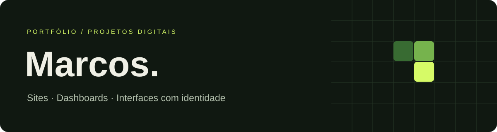

# Oi, eu sou o Marcos

**Sites personalizados · Dashboards · Interfaces de gestão**

Também conhecido como **SayNoob_TYT**, criador da TYT Studios.

[Explorar meu portfólio](https://in3zalo-gk.github.io/marcos-portfolio/) · [Conhecer os repositórios](https://github.com/in3zalo-gk?tab=repositories)

## O que estou construindo

Crio demonstrações de sites e interfaces para pequenos negócios, com foco em navegação clara, personalização e uso no celular. Também exploro Android, Roblox e Minecraft Bedrock.

Este perfil reúne projetos de estudo, experimentos e conceitos comerciais. As demonstrações abaixo **não representam clientes contratados ou resultados comerciais comprovados**.

## Foco atual: Material You Starter Kit

Estou desenvolvendo o **[Material You Starter Kit](https://github.com/in3zalo-gk/material-you-starter-kit)**, um kit open source com tokens CSS, demo web e exemplo Android em Kotlin e Jetpack Compose. Um espaço para explorar interfaces personalizáveis inspiradas em Material 3.

Projeto independente, em estágio inicial e sem vínculo com a Google.

## Projetos web para explorar

| Projeto | O que você pode testar | Links |
|---|---|---|
| **Atlas** | Dashboard financeiro, períodos, busca e exportação CSV | [Abrir demo](https://in3zalo-gk.github.io/atlas-dashboard/) · [Código](https://github.com/in3zalo-gk/atlas-dashboard) |
| **Fluxo** | Painel de pedidos, criação e atualização de status | [Abrir demo](https://in3zalo-gk.github.io/fluxo-painel/) · [Código](https://github.com/in3zalo-gk/fluxo-painel) |
| **Órbita** | Conceito SaaS com landing e workspace de tarefas | [Abrir demo](https://in3zalo-gk.github.io/orbita-saas/) · [Código](https://github.com/in3zalo-gk/orbita-saas) |
| **Portfólio** | Apresentação, filtros, temas e projetos interativos | [Abrir site](https://in3zalo-gk.github.io/marcos-portfolio/) · [Código](https://github.com/in3zalo-gk/marcos-portfolio) |
| **Zyon / conceito independente** | Vitrine, agendamento e painel simulados | [Abrir demo](https://zyon-conceito-demo.pages.dev/) |

> Dados e valores fictícios. Sem autenticação, pagamentos, agendamentos ou envio de pedidos reais. Os protótipos estáticos não substituem um sistema de produção. O conceito Zyon não possui vínculo ou aprovação da empresa.

## Outros caminhos que exploro

- **[IconBro](https://github.com/in3zalo-gk/IconBro):** fork comunitário não oficial do Iconify; suporte experimental ao Android 14. Créditos e limitações no projeto.
- **[MotoG24 QuickSettings](https://github.com/in3zalo-gk/MotoG24-QuickSettings):** protótipo reversível Xposed para tiles de configurações rápidas.
- **[LeviVision](https://github.com/in3zalo-gk/LeviVision):** projeto para LeviLaunchroid com compatibilidade antiga; desatualizado.
- **[NewbX DarkManager](https://github.com/in3zalo-gk/NewbX-DarkManager):** shader experimental; desatualizado e incompatível com 1.26.52+.

## Como gosto de criar

- **Identidade própria:** cores, tipografia e componentes que combinem com cada projeto.
- **Celular primeiro:** navegação direta e layouts que se adaptem à tela.
- **Interfaces úteis:** vitrines, dashboards e painéis com informações bem organizadas.
- **Transparência:** demonstrações identificadas e limitações documentadas.

## Tecnologias nos projetos

`HTML` · `CSS` · `JavaScript` · `Kotlin` · `Java` · `C++` · `Python`

## Minha atividade no GitHub

<picture>
  <source media="(prefers-color-scheme: dark)" srcset="https://raw.githubusercontent.com/in3zalo-gk/in3zalo-gk/main/assets/github-snake-dark.svg">
  <source media="(prefers-color-scheme: light)" srcset="https://raw.githubusercontent.com/in3zalo-gk/in3zalo-gk/main/assets/github-snake.svg">
  
</picture>

A cobrinha usa meu calendário real de contribuições e é atualizada diariamente por GitHub Actions. É uma animação SVG, não um jogo controlável dentro do perfil. Gerada com [Platane/snk](https://github.com/Platane/snk).

---
Marcos / SayNoob_TYT · TYT Studios · Portfólio em construção
