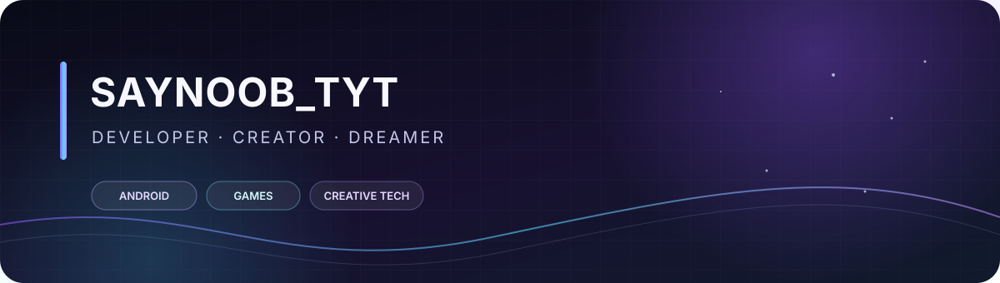

  

  <h1>Oi, eu sou SayNoob_TYT 👋</h1>
  
<strong>Desenvolvedor e criador de projetos digitais</strong>

  
Transformo ideias em apps Android, experiências no Roblox e projetos para Minecraft Bedrock.

---

### ✦ Sobre mim

Sou criador da **TYT Studios** e gosto de construir coisas que misturam tecnologia, criatividade e personalidade. Trabalho com desenvolvimento Android, jogos e personalização de experiências — sempre buscando soluções práticas e leves.

- 📱 Android: apps e personalização do sistema
- 🎮 Roblox: jogos, mecânicas e sistemas de gameplay
- ⛏️ Minecraft Bedrock: add-ons, shaders e RenderDragon
- 🧪 Também exploro automações e ideias experimentais

### 🚀 Projetos em destaque

| Projeto | Status / descrição |
|:--|:--|
| [**SmartIsland**](https://github.com/in3zalo-gk/SmartIsland) | Fork de código aberto para uma experiência Dynamic Island no Android; consulte a licença e os créditos originais |
| [**LeviVision**](https://github.com/in3zalo-gk/LeviVision) | Projeto para LeviLaunchroid — ⚠️ desatualizado; compatibilidade antiga |
| [**Newb X Dark Manager**](https://github.com/in3zalo-gk/NewbX-DarkManager) | Shader de fantasia sombria — ⚠️ desatualizado; não funciona em Minecraft Bedrock 1.26.52+ |

### 🛠️ Tecnologias e ferramentas

`Kotlin` · `C++` · `Lua` · `Python` · `Android` · `Roblox Studio` · `Minecraft Bedrock`

### 🌙 O que me inspira

Interfaces bem pensadas, mundos de fantasia, mods criativos e projetos que funcionam de verdade — inclusive em dispositivos mais simples.

  Feito com criatividade no Brasil 🇧🇷 · © 2026 SayNoob_TYT

